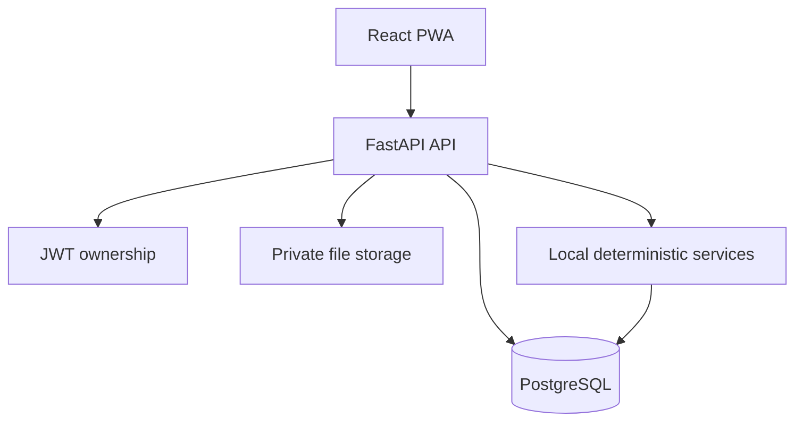
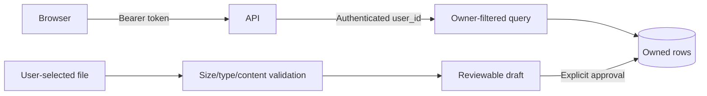
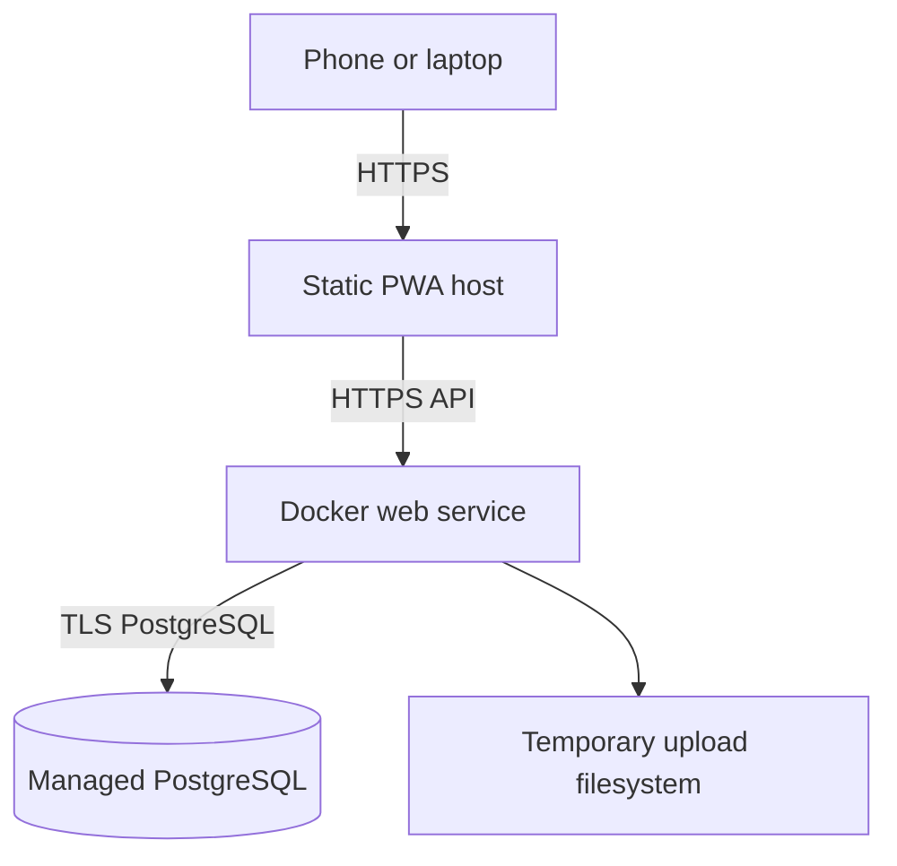

# NEXUS AI system architecture

## Product boundary

NEXUS AI is one ecosystem, not five independent applications. Authentication,
profile/preferences, PostgreSQL, uploads/imports, permissions, notifications,
Intelligence and the responsive PWA shell are shared infrastructure.

## Module flow

| Module | Main records | Processing boundary |
| --- | --- | --- |
| Knowledge | files, imports, documents, summaries | Upload, extract, review/save |
| Learn | goals, topics, progress, questions, attempts | Owned Knowledge source before quiz |
| Money | batches, drafts, transactions | Parse, edit, duplicate review, approve |
| Work | projects, plan imports, drafts, tasks | Parse, estimate range, edit, approve |
| Intelligence | runs and read-only results | Intent to allow-listed owner-safe tool |
| Notifications | durable in-app notices | Synchronize, deduplicate, read/delete |

## Trust boundaries

The browser never chooses an ownership `user_id`. IDs used for relationships
come from current-user list endpoints and stay internal in React state.

## Deployment shape

The free-tier production file system is temporary. PostgreSQL metadata persists,
but uploaded file bytes may be unavailable after a service replacement or
restart. Durable object storage is a documented post-MVP task.

## Migration rule

Schema changes are append-only Alembic revisions. The production container runs
`alembic upgrade head` before starting one API process. Applied migrations are
never edited. A problematic production schema change is handled with a reviewed
forward-fix migration unless a tested downgrade is explicitly justified.
